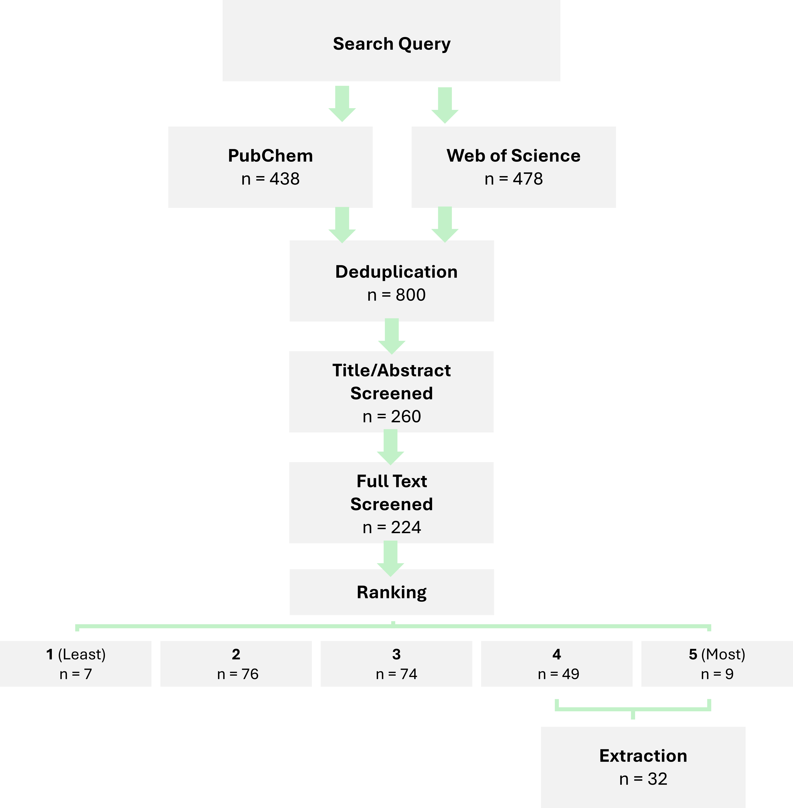

# Materials and Methods

```{r}
#| label: setup-methods
#| include: false
#| warning: false
#| message: false

# Lets this section render on its own (`quarto render _02-methods.qmd`). When the
# file is spliced into index.qmd via , index.qmd's own `setup`
# chunk has already loaded these and defined docx_flex(); re-running library()
# and redefining the function is harmless.
library(targets)
library(here)
library(tidyverse)
library(flextable)

# Needed here because `r vm_val(...)` is used inline further down (Vannmiljø
# section), and the table that used to define these lives in the SI now
# (_06-SI01.qmd), which renders AFTER this file in index.qmd's include order.
# _06-SI01.qmd's own tbl-vm-search/tbl-vm-dataset chunks redefine these too,
# harmlessly, so it still works if that file is ever rendered on its own.
vm_sum <- tar_read(vm_dataset_summary)
vm_val <- function(m) vm_sum$scale$value[vm_sum$scale$metric == m]

# Identical to the helper in index.qmd's setup chunk. Change one, change both
# (or promote it to an R/ function).
docx_flex <- function(ft, widths = NULL) {
  ft <- ft |>
    flextable::theme_vanilla() |>
    flextable::bold(part = "header") |>
    flextable::fontsize(size = 9, part = "all") |>
    flextable::padding(padding = 2, part = "all")
  if (is.null(widths)) {
    flextable::set_table_properties(ft, layout = "autofit", width = 1)
  } else {
    flextable::set_table_properties(
      flextable::width(ft, width = widths),
      layout = "fixed"
    )
  }
}
```

## Study Area

Hammerfest is a municipality ("kommune") and town in Finnmark, Norway's northernmost county. The area (@fig-repparfjorden-locator) is a dense archipelago of islands and peninsulas riven with fjords and valleys. To the north-east, the municipality opens into the Norwegian Barents Sea, which supports both a thriving fishing industry and multiple oil and gas wells. The municipality's south-west encompasses an area of the mainland which includes the Nussir and Ulveryggen mountains (home to an important copper deposit), and Repparfjord [@dalfestHammerfest2026]. Hammerfest municipality has a population of 11,000 (2025, expected to remain stable to 2050 [@statisticsnorwayFaktaOmKommunen2025]), of which roughly 8,000 live in the town itself, 2,000 in the southerly village of Rypefjord, and 300 in the mainland village of Kvalsund. Many of Hammerfest's population are employed in natural resource-based industries (@tbl-hammerfest-employment), and relative to its population (roughly 0.2% of mainland Norway's working population) the municipality hosts a sizeable share of these sectors [@statisticsnorway08536EmployedPersons2026].

The municipality contains 18 Pollutant Release and Transfer Register (PRTR)-registered facilities [@norwegianenvironmentagencyNorwegianPRTRNorske2026], the most notable of which is the Melkøya Liquid Natural Gas plant, which receives gas from the Snøhvit gas and condensate field to the north. Other notable facilities include Hammerfest Airport, several active and former landfills and submarine disposal areas in the vicinity (including the Repparfjord Submarine Tailings Disposal), a handful of industrial installations, and the Wastewater Treatment Plant (WWTP) at Rossmolla, Hammerfest (online 2016, primary treatment), which serves both Hammerfest town and Rypefjord and discharges into the Sørøysundet [@fylkesmannenifinnmarkTillatelseEtterForurensningsloven2014]. Of these 18 facilities, 5 have reported copper emissions to the environment. Hammerfest town harbour has a long history of heavy metal and organic pollution [@vannportalenProsjektHammerfestRen2022], and was identified as a priority site ("Norway most polluted harbour" [@svendsenVarNorgesMest2024]) for cleanup under the project *Ren Havn* (Clean Harbour). The project aimed to reduce concentrations of lead, PAH16, and PCB7 to below Norwegian status class III (i.e. good or background levels of pollution with no adverse effects expected) by dredging polluted sediments and depositing them inside harbour infrastructure. This was successfully completed in 2023/2024 [@norwegiancoastaladministrationHammerfestRenHavn2019; @nccNCCHarOverlevert2023].

The Nussir and Ulveryggen mountains were mined intermittently for copper in the early 20th century and then intensively between 1972 and 1978 by the firm Folldal Verk [@sternalImpactSubmarineCopper2017]. During this period, copper-rich tailings were processed and discharged to shallow waters in the inner Repparfjord [@sternalImpactSubmarineCopper2017; @kvassnesWasteSitesMines2013]. In 2019, the firm Nussir ASA was licensed to conduct mining operations at Nussir/Ulveryggen [@eilertsenNussirGetsOperating2019]. In 2021, it received permission to discharge tailings to the Repparfjord, and in 2025, its waste handling plan was approved by the Norwegian Environment Agency (NEA), subject to a public hearing [@norwegianenvironmentagencyNussirCopperProject2025]. Mining is planned to begin in late 2027 [@olaussenSisteBrikkePa2026] and continue for 13 years, and is estimated to release at most 30 million tonnes of tailings to the Repparfjord over its period of operation (@fig-repparfjorden-locator c).

<!-- TODO: P4: Text still not big enough on map. -->

![Maps of study area: a) Finnmark county (in white) is Norway's northernmost county. Hammerfest municipality is located coastally near the Norwegian Barents Sea. b) Hammerfest municipality encompasses the island Kvaløya and its surrounding water body Sørøysundet, as well as an area of the mainland to the south, including Repparfjord. In the Barents Sea, the Snøhvit field supplies natural gas which is processed at the city's harbour. c) Kvaløya and Hammerfest are home to several industrial and aquaculture facilities. Repparfjord is the historical site of submarine disposal of copper mine tailings, as well as the site of a new mine planned to begin operation in 2027. All feature coordinates are approximate. Base maps: @massicotteRnaturalearthWorldMap2026; Administrative boundaries: @whiteCsmapsPreformattedMaps2026; Map tiles: @geonorgeTopographicMapNorway2023.](figures/fig03-study-area.png){#fig-repparfjorden-locator}

Aquaculture is also an important industry in Hammerfest, with just under 5% of the municipality's population employed in fishing and aquaculture ([@tbl-hammerfest-employment]). Norway's aquaculture registry reports 29 (22 active, 7 inactive) licensed facilities in the municipality, all of which cultivate salmonids [@norwegiandirectorateoffisheriesAquacultureLocationsNorway2025]. Copper is used in aquaculture both as an essential nutrient present in feed and as an antifouling coating on fish cages [@grosvikKunnskapsstotteOmMiljoeffekter2023].

## Lines of Evidence

Multiple Lines of Evidence (LoE) were gathered in order to construct AEPs. Each LoE represents a largely homogeneous data type and provides evidence (directly or indirectly) for the presence of copper one or more KES or movement of copper across one or more KTR.

Key lines and their characteristics are summarised in @tbl-lines-of-evidence, and reviewed in detail below.

```{r}
#| label: tbl-lines-of-evidence
#| tbl-cap: "Table of key Lines of Evidence (LoE) used in the construction of AEPs. Includes dominant data types and the Key Exposure States (KES) and Key Transitional Relationships (KTR) of which they provide evidence."
#| echo: false
tibble::tribble(
  ~`Line of Evidence`                                        , ~`Data Type`                                          , ~`AEP Element`                                  , ~Notes                                                                                                                                                                                                                                         ,
  "Systematic Literature Review"                             , "Exposure (concentrations)"                           , "Exposure Medium, Target Site Exposure"         , "Primary data source, extracted structured data and processed as part of the Key Exposure States Dataset."                                                                                                                                     ,
  "Ad hoc literature"                                        , "Exposure (concentrations), Mass Balance (mass/time)" , "Source, Exposure Medium, Target Site Exposure" , "Used to gap-fill AEPs where KES/KTR were suspected, but no relevant evidence was found in existing lines of evidence"                                                                                                                         ,
  "Vannmiljø Database"                                       , "Exposure (concentrations)"                           , "Exposure Medium, Target Site Exposure"         , "Processed as part of the Key Exposure States Dataset."                                                                                                                                                                                        ,
  "Norwegian Product Register"                               , "Embedded Mass Balance (mass/year)"                   , "Source KTR"                                    , "Self-reported import-export of copper, per product/industry. Available only at whole-Norway scale."                                                                                                                                           ,
  "Norwegian PRTR"                                           ,"Mass Balance (mass/time)"                            , "Source KES"                                    , "Measured/modelled emissions of copper to air/water (kg/per) self-reported by individual industrial, aquaculture, wastewater, and other facilities. Methodology not available. Published under website Norske utslipp ('Norwegian Emissions')" ,
  "Aquaculture Registry"                                     , "Facility location and size"                          , "Source KES"                                    , "Registry of aquaculture facilities, including size, name, and coordinates. Joined to PRTR emissions data by facility name.."                                                                                                                  ,
  "Copper Toxicity/Safety Thresholds"                        , "Thresholds (concentration)"                          , ""                                              , "Various EU and Norwegian quality standards were used to provide an assessment of which samples showed probable pollution."
) |>
  flextable::flextable() |>
  flextable::compose(
    i = 2,
    j = "Line of Evidence",
    value = flextable::as_paragraph(flextable::as_i("Ad hoc"), " literature")
  ) |>
  docx_flex(widths = c(1.15, 1.35, 1.05, 2.72))
```

## Key Exposure States Dataset

All data processing and analysis was conducted using the programming language *R* (version 4.6.1) [@rcoreteamLanguageEnvironmentStatistical2026].

### Source Key Exposure States

@comberSourcesCopperEuropean2023 provides a comprehensive overview of copper sources to freshwater and transitional waters in European Union (EU) member states (and in some cases Norway). Direct applicability to the Hammerfest and Repparfjord study areas was limited as these areas deviate substantially from the European norm (highly limited agriculture, few emissions to freshwater compartment, etc.). Thus, the study was used to identify gaps in Norway/Hammerfest-specific lines of evidence. Where a copper source was believed to exist (from @comberSourcesCopperEuropean2023 or local evidence), but no more specific data were available, data from this study were used to construct putative source KESs without a magnitude estimate. Sources from @comberSourcesCopperEuropean2023 were grouped together for AEP construction: *Anthropogenic run-off*, representing copper entering ecosystems from road vehicle wear, construction materials, industrial emission or deposition to land, fertiliser application and manure; *Natural run-off*, representing soil loss and atmospheric deposition from natural sources, and *Vessel antifoulants*, representing copper emissions from leisure, trade, and transport vessels. *Vessel antifoulants* was excluded from the Repparfjord AEP, as it was not judged to be a relevant source. *Industrial emissions* and *Aquaculture* were averaged from reported emissions for facilities in the Hammerfest study area. As no data were available for WWTP releases for Hammerfest, data for a similar (primary treatment, Arctic town) WWTP were used and adjusted by population.

Repparfjord's Submarine Disposal Site copper content was quantified based on the frequently reported figure of 1 million tonnes of tailings [@kvassnesWasteSitesMines2013], at 707-1090 mg/kg copper (@sternalImpactSubmarineCopper2017, citing @kleivFysiskeOgKjemiske2011, but original document not available). The midpoint of this concentration (898 mg/kg) was multiplied by 1 million tonnes to arrive at an estimate of roughly 898.5 tonnes embedded copper.

<!-- TODO: We also don't have data for the most sensitive lifestages -->

### Environmental, External Exposure, and Internal Exposure Key Exposure States

#### Literature Review Protocol

A systematic literature review framework was adapted from elements of the Preferred Reporting Items for Systematic Reviews and Meta-Analyses (PRISMA2020) framework (@pagePRISMA2020Statement2021). As PRISMA2020 is primarily concerned with intervention-based studies, some work was required to adapt to the scope and exigencies of an environmental exposure assessment. A full PRISMA2020 checklist is available in the Supplementary Information.

Web of Science (Core Collection) and PubMed were searched for material relevant to copper occurrence, behaviour and ecotoxicology in the Arctic. Returned papers were de-duplicated, screened at the abstract and full text levels, and ranked subjectively from 1-5 based on the quantity and relevance of reported data to the research question. Due to time and staffing constraints, the decision was made to proceed with extraction with a subset of the papers, selected on the basis of this score. Although this compromises the systematicity of the literature review, it was judged necessary to complete the study within the time available. 32 of the highest-scored papers (ranking of 4+) were selected for data extraction ([@fig-prisma]).

{#fig-prisma width="500"}

#### Data Extraction & Validation

Concentration data (i.e. mass per volume of water, and dry/wet mass ratio), and metadata (information on the associated compartment, reference, sampling sites, techniques, and if relevant biota) were extracted and structured from study full texts using the eData application [@welchEDataToolFormat2026]. The eData format consists of 11 interlinked tables and controlled vocabulary for describing pollution, while the eData application is an accompanying Shiny application that provides a user interface for extraction, validation, and export of these data. For each paper, data were extracted and formatted from the study PDF using a large language model (LLM) call (Claude Sonnet 4) consisting of the study PDF, a prompt describing the desired extraction, and a schema constraining the output to the eData format [@anthropic2024extracting_json]. Returned data were then visually inspected and validated and any missing information added. Finally, the relevance and reliability of each study to address our problem formulation was evaluated using the Criteria for Reporting and Evaluating Exposure Datasets (CREED) framework [@dipaoloImplementationCREEDApproach2024] against a set of questions developed for this study (See SI). For each study, the final dataset was exported as a collection of comma-separated values. Each dataset was subsequently checked for internal consistency and correctness to format with the eData format's validation functions, and combined into a single data table. Data extraction was performed by one of three reviewers who also reviewed the extracted data against the study text before exporting.

#### *Ad hoc* literature

Where data gaps were identified, or where relevant Lines of Evidence were suspected or known to exist but were not captured by the existing data set, *ad hoc* searches were performed to locate potentially relevant literature. Two studies (@tbl-adhoc-literature) were included from *ad hoc* searches. Where these pieces of evidence contained data deemed relevant, they were reviewed and data extracted (using the eData application if containing exposure data; otherwise, by hand).

#### Vannmiljø

In addition to data from literature, all available monitoring data on copper and copper-containing substances (in practice, only elemental copper) across all media and monitoring campaigns and the full geographical extent of Norway (including Svalbard and Jan Mayen) were extracted from the database Vannmiljø [@norwegianenvironmentagencyVannmiljo2026] (@tbl-vm-search).

These search criteria returned 90,115 rows of copper concentrations and 24,684 unique sites at which copper was monitored, across `r vm_val("Monitoring campaigns")` campaigns. `r vm_val("Censored (< LOD / < LOQ)")` rows reported values below a limit of detection (LOD) or limit of quantification (LOQ) (see @tbl-vm-dataset, Supplementary Information, for a summary). In addition, descriptive tables of method IDs, measurement units, measured matrix IDs, and monitoring campaigns were compiled. Extracted data were processed and programmatically converted to the eData format, and checked for internal consistency and correctness to format with the eData format's validation functions.

#### Exposure Data Post-Processing

Once literature review and Vannmiljø data were joined, data processing and cleaning were performed. Units and values were standardised to µg/L (concentrations) for waterborne copper or mg/kg (dry or wet weights) for sediment and biota as appropriate. Values reported as below LOD/LOQ were not used in further processing of the data.

Exposure data were then grouped based on eData's environmental compartment and site type vocabulary: *environmental compartment* (e.g. Aquatic, Terrestrial, Biota), *environmental subcompartment* (e.g. Aquatic: sediment, freshwater, marine/salt water), *site geographical feature* (e.g. Coastal, fjord; River, stream, canal; Ocean, sea) and *sub-feature* (e.g. water column, water benthos). Additionally, biota samples were classified by *species* and *tissue* (e.g. muscle, liver), and standardised unit (i.e. dry and wet weights, where both units were present for a single group). Any remaining invalid (i.e. value = NA) rows of data were excluded, and the proportion of excluded rows recorded. Each group was given a sequentially numbered ID (GXXX); these Group IDs are used as shorthand to refer to specific groups. Where both dry weight and wet weight data were available for a single group, data with the most common unit were retained and the remainder excluded.

An overview of the combined (Vannmiljø and literature) dataset by environmental compartment is given in the Supplementary Information (@tbl-literature-dataset).

For each sample grouping, sample size, mean, median, standard deviation, number of outliers meeting *both* Tukey Fences ($Z >= 1.5$) [@hoaglinPerformanceResistantRules1986] and Robust-Modified Z-Score ($Z >= 3.5$) [@iglewiczHowDetectHandle1993], and Hartigan's dip test statistics ($P <= 0.05$) [@hartiganDipTestUnimodality1985; @maechlerDiptestHartigansDip2025] were calculated. Where extracted data were reported with uncertainty (SD, SE, range, etc.), these were discarded (note that this represents a strict minority of data, as Vannmiljø reports individual data points). Sample groups were ordered based on sample size and flagged for inspection where they met one of the following criteria:

1.  The group represented a matrix that was essential for the construction of marine Arctic AEPs (e.g. matrices that are both receiving compartments for copper and habitats for organisms of interest, such as marine and freshwater water columns and sediment, or algae (due to their trophic position))
2.  The group's distribution was flagged as potentially multimodal by Hartigan's dip test
3.  Over 5% of the group's total sample size (based on `MEASURED_N`) was double-flagged as an outlier based on Tukey fences and Robust-Modified Z-Score

Where any of these criteria were met, distributions and outliers were inspected manually for potential causes. Where errors were identified as being introduced during extraction/conversion, affected data points were excluded.

### Environmental Quality Standards and Reference Concentrations

In order to assess the degree of contamination a given concentration in a given matrix represented, a selection of published threshold levels for copper concentrations was assembled. The NEA publishes both Environmental Quality Standards (EQS) derived from Species Sensitivity Distributions (SSDs) [@norwegianenvironmentagencyThresholdsClassificationWater2020] and PROREF, *provisional high reference contaminant concentrations* for specific organism tissues which represents the 95th percentile of concentrations found at reference (i.e. sites selected for comparison based on their lack of contamination) stations in the NEA's marine pollutant monitoring programme [@schoyenContaminantsCoastalWaters2025, 94-95]. Copper PROREFs are published for Atlantic cod (*Gadus morhua*) and Blue mussels (*Mytilus edulis*). Quality standards ("Tilstandsklasser") are set for freshwater, sediment (fine-grained, consisting of clay and/or silt), and coastal water ([@tbl-copper-thresholds]). These PROREF and quality thresholds are used to assess the degree of contamination of sampling groups and for the interpretation of the concentrations associated with specific Key Exposure States.

### AEP Construction

Based on exploration of copper pollution sources and dynamics in the study area, the decision was made to construct two AEPs: one representing the inner-Repparfjord submarine tailings disposal area, and another the Hammerfest coastal area (@tbl-aeps). For each case study, a bounding box was set based on the physical extent of the relevant environmental system and the distribution of sampling and emissions points. For each sample group with at least one sampled point inside the bounding box, data were aggregated and summary statistics calculated. In one group, reported data inside the bounding box were assessed to be improbably high (a measured concentration of 1,600 mg/kg in river sediment). In this case, data for river water and sediment across the Norwegian Arctic (i.e. all river water/river sediment data above 66.5 N) were used. These groups are marked in the AEP with a globe symbol.

Draft AEPs of putative KES and KTR were constructed for both the Repparfjord and Hammerfest systems, and LoE available for these areas reviewed. In most cases, cross-over between the KES judged most relevant to a study system and available data was considerable. For example, sediment measurements of copper were available in quantity for both AEP systems over the study period. In some cases, sampling groups representing multiple species (e.g. the multiple fish species sampled by [@kogelUsingAtlanticHaddock2026]) were grouped together in one node for each tissue type. Because most of the LoE collected related to exposure data, KTR were more often defined from expert judgement than KES. This is reflected in the WoE assessment below.

::: landscape
```{r}
#| label: tbl-aeps
#| tbl-cap: "Table of Aggregate Exposure Pathways, reporting WGS84 dimensions, number of samples, number of Key Exposure States and references captured by bounding box (exposure data only), and date range of included data. Note that N samples is inflated for Repparfjord AEP due to use of Norwegian Arctic data for fjord and river nodes."
#| echo: false

manifest <- tar_read(aep_manifest)
aep_nodes_tbl <- tar_read(aep_nodes)
cards <- tar_read(aep_node_cards)
members <- tar_read(aep_node_members)
membership <- tar_read(aep_membership)

emp_cards <- cards |> filter(node_type == "empirical")

samples_dates_per_aep <- emp_cards |>
  group_by(aep_id) |>
  summarise(
    n_samples = sum(n, na.rm = TRUE),
    data_date_min = suppressWarnings(min(date_min, na.rm = TRUE)),
    data_date_max = suppressWarnings(max(date_max, na.rm = TRUE)),
    .groups = "drop"
  )

nodes_per_aep <- membership |>
  inner_join(aep_nodes_tbl |> select(node_id, node_type), by = "node_id") |>
  # many-to-many is genuine here: a node shared by >1 AEP contributes one row
  # per (aep_id, node_id), and each of those fans out to that node's group_id
  # rows in `members`. The result is one row per aep_id/node_id/group_id
  # triple, which is what n_distinct(group_id) below needs.
  group_by(aep_id) |>
  reframe(n_nodes = n())

refs_per_aep <- emp_cards |>
  filter(!is.na(references), nzchar(references)) |>
  group_by(aep_id) |>
  summarise(
    n_references = length(unique(unlist(str_split(references, ",\\s*")))),
    .groups = "drop"
  )

manifest |>
  left_join(samples_dates_per_aep, by = "aep_id") |>
  left_join(nodes_per_aep, by = "aep_id") |>
  left_join(refs_per_aep, by = "aep_id") |>
  transmute(
    Label = label,
    # Strips the leading "Bounding box <lon> E, <lat> N." sentence, now
    # redundant with the four bbox columns. [^.]+ alone stops at the first
    # decimal point inside the coordinates (e.g. "23.40"), so the pattern is
    # anchored on the literal "N." that always closes this sentence instead.
    `Scope note` = str_remove(
      scope_note,
      "^Bounding box [0-9.]+-[0-9.]+ E, [0-9.]+-[0-9.]+ N\\.\\s*"
    ),
    `Lat min (S)` = sprintf("%.2f", lat_min),
    `Lat max (N)` = sprintf("%.2f", lat_max),
    `Lon min (W)` = sprintf("%.2f", lon_min),
    `Lon max (E)` = sprintf("%.2f", lon_max),
    `N samples` = formatC(n_samples, format = "d", big.mark = ","),
    `N KES` = n_nodes,
    `N references` = n_references,
    `Date range` = paste0(
      format(data_date_min, "%Y"),
      "-",
      format(data_date_max, "%Y")
    )
  ) |>
  flextable::flextable() |>
  flextable::set_header_labels(Label = "Label", `Scope note` = "Scope note") |>
  docx_flex(widths = c(1.2, 2.1, 0.7, 0.7, 0.7, 0.7, 0.9, 0.7, 0.9, 0.9))
```
:::

Target Site of Exposure KES for both real-world AEPs were constructed based on available exposure data.

### Weight of Evidence Assessment

Construction of the AEP required the quantitative assessment and comparison of diverse lines of evidence on copper occurrence, emissions, and dynamics [@hardyGuidanceUseWeight2017].

Evidence quality for each KES and KTR was assessed against the hypothesis that copper was present at a KES, or flowed along a KTR. Each KES and KTR was scored according to the Essentiality, Plausibility, Evidence, and Quantification (abbreviated to EPEQ) of copper presence/flows, based on the AOP WoE assessment guidelines [@oecdUsersHandbookSupplement2018] adapted by @pengAggregateExposurePathways2022. These criteria are summarised in @tbl-woe-criteria.

In some cases, KESs and KTRs were given high EPEQ scores despite a lack of evidence in the available data due to the extreme degree of consensus on occurrence. For example, the natural occurrence of copper in the Earth's crust and sea water are both considered axiomatic, and relevant groups (e.g. fjord water or natural runoff) were thus scored as highly essential, plausible, and evidence-based despite the absence of e.g. geological data in this paper's LoE.

::: landscape
```{r}
#| label: tbl-woe-criteria
#| tbl-cap: "Weight of Evidence assessment criteria for Key Exposure States (KES) and Key Transitional Relationships (KTR) adapted from @pengAggregateExposurePathways2022, @oecdGuidingPrinciplesKey2019, and @dipaoloImplementationCREEDApproach2024. CREED: Criteria for Reporting and Evaluating Exposure Datasets."
#| echo: false
tibble::tribble(
  ~Criterion, ~`Key Exposure State (KES)`, ~`Key Transitional Relationship (KTR)`, ~Score, ~Comments,
  "Essentiality",
  "Copper presence in downstream KES will be reduced/stopped if copper presence in this KES is reduced/stopped",
  "Copper presence in downstream KES will be reduced/stopped if this KTR is reduced/stopped",
  "3: Diverse, consistent evidence
2: Some, potentially inconsistent evidence
1: Weak or no evidence",
  "Due to wide range of copper emissions sources and variety of uptake routes, most KES/KTR are less essential.",
  "Plausibility",
  "Theoretical knowledge supports dependent and sequential change of two adjacent KESs",
  "Theoretical knowledge supports KTR as mechanism of sequential change between KESs",
  "3: Diverse, consistent evidence
2: Some, potentially inconsistent evidence
1: Weak or no evidence",
  "Environment-level occurrence and transport of stressors is far more intuitively and widely understood than metabolic processes. Most copper KESs and KTRs will be scored as highly plausible.",
  "Evidence",
  "Empirical data on occurrence of copper at KES (above background levels, if available).",
  "Empirical data on transfer along KTR between KESs",
  "3: Diverse, consistent evidence.
2: Some, potentially inconsistent evidence
1: Weak or no evidence",
  "Vast majority of available evidence is occurrence rather than transport/flows. CREED Reliability score (1-5) and quantity of relevant evidence used in calculation of Evidence score.",
  "Quantification (Quantitative Understanding)",
  "Quantitative models exist permitting prediction of downstream KESs from upstream KESs",
  "Quantitative models exist permitting prediction KTR rates of transfer based on KESs and environmental parameters",
  "3: High-quality quantitative prediction of downstream KESs occurrence from upstream KES occurrence
2: Limited or only partially applicable prediction
1: Qualitative predictions only",
  "A full-scale review of available models has not been carried out."
) |>
  flextable::flextable() |>
  docx_flex(widths = c(1.2, 2.6, 2.6, 1.6, 1.69))
```
:::